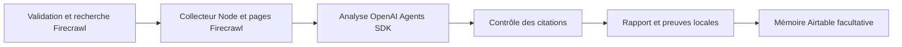

# Intégrations OSINT

Le collecteur Node existant est conservé. Un pipeline Python LangGraph appelle
ce collecteur par entrée/sortie JSON, ajoute les documents Firecrawl, puis
utilise OpenAI Agents SDK pour l'analyse. La vérification déterministe contrôle
les citations avant sauvegarde locale et synchronisation Airtable facultative.



## Installation

Prévoir Node.js 24+, Python 3.12+ et uv. Depuis la racine du dépôt :

```bash
uv sync --locked --group dev
uv run python -m osint_pipeline doctor
uv run python -m osint_pipeline check-airtable
```

Les versions directes sont fixées dans `pyproject.toml` et la résolution complète
dans `uv.lock`. La commande `doctor` affiche uniquement présence/absence des
variables, sans afficher leurs valeurs ni effectuer d'appel facturé.

## Configuration

Le processus lit les variables d'environnement puis, si présent, `.env.local`
dans ce dépôt, sans remplacer les variables déjà définies. `.env.example` donne
les noms requis sans secrets. Configurer les secrets via un mécanisme sécurisé,
jamais dans une conversation, un fichier suivi par Git ou une ligne de commande.
Les identifiants des connecteurs ChatGPT ne sont pas automatiquement disponibles
pour cette application locale.

| Variable | Usage |
| --- | --- |
| `OPENAI_API_KEY` | Authentification runtime OpenAI |
| `OPENAI_MODEL` | Modèle compatible Responses et sortie structurée ; défaut `gpt-5-mini` |
| `FIRECRAWL_API_KEY` | Recherche et collecte via API v2 |
| `AIRTABLE_TOKEN` | PAT avec accès à la base et scopes adaptés |
| `AIRTABLE_BASE_ID` | Identifiant `app…` d'une base existante |

Le modèle par défaut est configurable : aucun accès à ce modèle n'est présumé.
Aucun secret n'est créé ou enregistré par ce pipeline.

## Exécution

```bash
# Recherche Firecrawl, collecteur existant, analyse IA et rapports locaux
uv run python -m osint_pipeline run example.com --type domain --max-pages 3

# Même pipeline avec écriture explicite dans la base Airtable configurée
uv run python -m osint_pipeline run example.com --type domain --sync-airtable

# Collecteur et orchestration sans services nécessitant une clé
uv run python -m osint_pipeline run example.com --type domain --no-ai --no-firecrawl
```

La configuration est vérifiée avant les appels payants. Si la synchronisation
est demandée, le schéma Airtable est aussi contrôlé avant collecte. Le mode sans
IA/Firecrawl interroge néanmoins les API publiques du collecteur Node : ce n'est
pas un mode hors ligne.

Les sorties apparaissent dans `reports/<run-id>/` : rapport JSON et Markdown,
graphe JSON, journal JSONL et reçu `integration.json`. Le reçu indique l'état de
la mémoire distante et les éventuels échecs d'intégration. Le journal local est
préservé même si Airtable est indisponible. Le statut `partial` du rapport indique
des erreurs de collecte ou d'analyse ; une synchronisation échouée figure dans
le reçu et entraîne un code de sortie 1. La collecte partielle seule est rendue
avec son statut explicite, sans code d'erreur supplémentaire.

## Préparer Airtable

Choisir une base existante, idéalement dédiée. La commande suivante crée
uniquement les cinq tables manquantes et vérifie les tables déjà présentes :

```bash
uv run python -m osint_pipeline init-airtable
```

Cette commande modifie la base configurée. Elle n'efface ni table ni champ et
n'altère pas un schéma existant incompatible. Les scopes nécessaires sont
`schema.bases:read`, `schema.bases:write` pour l'initialisation, et
`data.records:write` pour la synchronisation. Le compte doit avoir les rôles
permettant ces opérations. En fonctionnement normal, `schema.bases:write`
n'est pas nécessaire.

Toutes les tables existantes sont vérifiées avant la première création. Une
réponse de schéma illisible ou une table incompatible interrompt l'initialisation
sans mutation. Les créations elles-mêmes ne sont pas transactionnelles : après
une interruption distante, la commande peut être relancée.

| Table | Contenu et clé d'upsert |
| --- | --- |
| Runs | Cible, dates, statut, compteurs ; UUID d'exécution |
| Sources | Fournisseur et état ; UUID + identifiant fournisseur |
| Observations | URL, titre, extrait, hash, statut ; identifiant stable du contenu |
| Claims | Affirmations et statut ; UUID + identifiant stable d'affirmation |
| EvidenceLinks | Provenances et citations ; identifiant stable de relation |

Les relations utilisent des clés externes textuelles explicites, sans prétendre
créer des champs Airtable de type linked-record. Les lots comportent au maximum
dix enregistrements, sont espacés et utilisent `performUpsert` sur `Key`. Les
extraits Airtable sont limités à 50 000 caractères ; le rapport local conserve
l'extrait collecté complet. Les valeurs ne sont pas converties automatiquement
en sélecteurs ni en formules. Les observations répétées entre exécutions sont
réutilisées, tandis que leurs provenances restent rattachées à chaque run.

## Reprise après erreur

```bash
uv run python -m osint_pipeline sync-airtable reports/<run-id>/report.json
```

Cette commande réutilise les mêmes clés : elle permet de reprendre des lots déjà
partiellement envoyés sans nouvelles dépenses OpenAI ou Firecrawl. Elle ne
réexécute ni recherche ni analyse. Les tables ne sont pas mises à jour dans une
transaction globale ; un échec peut laisser une partie des lignes synchronisées.
Le reçu local n'est marqué `synced` qu'après réussite de tous les lots.
Éviter plusieurs synchronisations simultanées vers la même base : Airtable ne
fournit pas ici de contrainte d'unicité transactionnelle sur les clés externes.

## Budgets et fiabilité

- Une recherche Firecrawl et au maximum `--max-pages` scrapes (1 à 10, défaut 3).
- Aucun navigateur interactif, aucune action de formulaire, aucun crawl récursif.
- URL HTTP(S) seulement, ports standard et rejet des adresses manifestement
  privées/locales. Ce filtre ne garantit pas l'absence de DNS rebinding ; les
  protections du service de collecte restent nécessaires. Aucun contournement
  d'authentification ou de restriction d'accès n'est implémenté.
- Pages Firecrawl tronquées à 12 000 caractères ; modèle limité aux vingt
  premières observations et 2500 caractères par extrait, 2500 tokens de sortie,
  un tour SDK, délai global de 60 secondes pour l'analyse.
- Le SDK utilise `store=False` et les traces SDK sont désactivées. Le contenu
  est néanmoins envoyé à OpenAI pour analyse et à Airtable si la sync est activée.
- Deux reprises au maximum pour les limites explicites des services HTTP ;
  attente `Retry-After` bornée à trente secondes. Les POST de collecte ne sont
  pas automatiquement rejoués après une erreur de transport ambiguë ou 5xx.
- Les textes des pages sont des données non fiables. Le modèle n'a aucun outil
  d'action et ne peut déclencher la synchronisation ou changer les destinations.
- Une citation contrôlée reçoit le statut `citation_matched`, jamais `verified`.
  Une citation inconnue ou non présente textuellement est rejetée. Ce contrôle
  ne prouve pas que la citation soutient logiquement l'affirmation. Les résumés
  restent explicitement des sorties IA non vérifiées.

Ne déployer ni exposer l'API publiquement sans la validation humaine prévue
dans le plan initial. Aucun service permanent n'est lancé par l'installation.

## Validation

```bash
npm test
uv run python -m pytest -q
```

Les tests Python exécutent le vrai graphe LangGraph et le vrai `Runner` de
l'Agents SDK, avec modèle déterministe et transport HTTP simulés. Ils contrôlent
les contrats Firecrawl v2 et Airtable, la sauvegarde avant mémoire distante, la
reprise idempotente, les citations inventées, les budgets et les erreurs. Ils ne
valident pas les droits, crédits, modèles accessibles ou schémas réels d'un compte.

Lors de l'implémentation, aucun identifiant runtime OpenAI, Firecrawl ou Airtable
n'était configuré : les appels authentifiés réels n'ont pas été exécutés.

Validation du 19 octobre 2026 : **25 tests Node et 21 tests Python réussis**.
Un essai réel du graphe en mode sans IA/Firecrawl a généré 18 observations et les
cinq fichiers attendus ; les sources publiques indisponibles ont laissé le
rapport en état `partial`. Un lancement avec intégrations activées et variables
absentes a bien échoué avant tout appel payant.

Les tests sont aussi définis dans `.github/workflows/tests.yml` pour les PR et
les mises à jour de `main`. Ils n'utilisent aucun secret de service et ne
déclenchent ni collecte payante, ni analyse distante, ni écriture Airtable réelle.

Un contrôle séparé, `.github/workflows/airtable-access.yml`, utilise le secret
GitHub `AIRTABLE_TOKEN` pour lire le schéma de la base sélectionnée. Il ne modifie
aucune table ni aucun enregistrement et ne demande aucune clé OpenAI ou Firecrawl.
Ce contrôle est limité à la branche d'implémentation dans le même dépôt ; il est
exclu des PR provenant de forks. La commande `check-airtable` exige uniquement
le jeton Airtable et l'identifiant de base, puis affiche compatibilité et nombre
de tables sans afficher le jeton.

## Références officielles consultées

- [Agents SDK Python](https://openai.github.io/openai-agents-python/quickstart/)
- [LangGraph Graph API](https://docs.langchain.com/oss/python/langgraph/quickstart)
- [Firecrawl Search v2](https://docs.firecrawl.dev/api-reference/endpoint/search)
- [Firecrawl Scrape v2](https://docs.firecrawl.dev/api-reference/endpoint/scrape)
- [Airtable upsert](https://airtable.com/developers/web/api/update-multiple-records)
